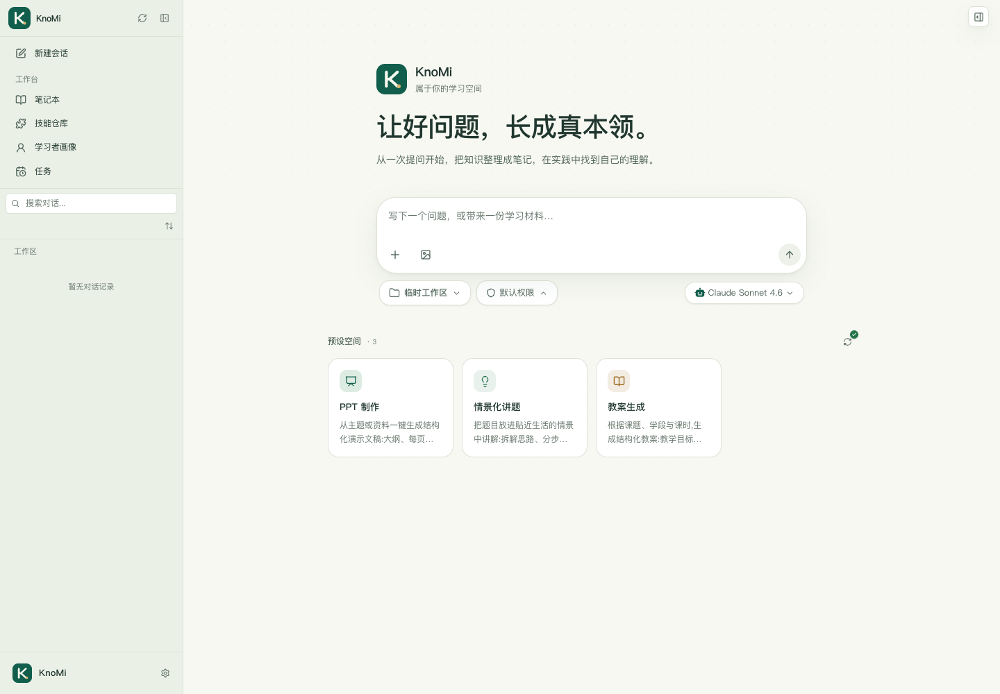

# KnoMi

**让好问题，长成真本领。**

KnoMi 是个人学习工作空间：围绕对话整理知识、保存可修正的学习记录，并在文件和终端中练习。提供 Web 界面、Electron 桌面入口和 `knomi` 终端命令。



## 可以做什么

- 对话与材料：流式回答、文件上传、Markdown/公式/图表展示、分支编辑和会话回放导出。
- 分层记忆：学习档案、Wiki 笔记与知识图谱、跨会话检索；每一层都可单独开关。
- 实践与复习：工作区文件预览和编辑、Conda Python 与其他语言的终端运行、定时学习任务。
- 内容与连接：内置教案、演示文稿及情境讲解模板；可配置自己的内容库、模型服务和消息渠道。

这是单人使用的本地应用。一个进程串行执行代理任务；被占用的会话会返回忙碌状态。服务没有多租户或登录认证功能，适合本机访问。

## 安装

需要 Conda、Git 和原生模块编译工具。macOS 使用 Command Line Tools；Linux 需要 C/C++ 编译器与 make。Python 和 Node.js 统一安装在项目的 Conda 环境内。

```bash
conda env create --prefix ./.conda-env --file environment.yml
conda activate ./.conda-env
export npm_config_python="$CONDA_PREFIX/bin/python"
npm ci
npm run build
```

环境约定：Node.js 22、Python 3.12。Python 文档预览只接受 Conda 解释器，不会回退到系统 Python。Windows 激活环境后使用对应的 Conda Python 路径设置 `npm_config_python`。

## 启动

macOS / Linux：

```bash
./run.sh
```

打开 <http://localhost:3000>。脚本首次运行时建立 `runtime/config/config.json`；在“设置 → 模型”中配置自己的服务地址、API Key 和模型。示例地址是不可连接的占位地址，真实模型对话需要完成配置。

其他启动方式（先激活 Conda 环境并创建配置目录）：

```bash
mkdir -p runtime/config runtime/data runtime/skills workspace
cp config.example.json runtime/config/config.json   # 仅首次配置时执行
npm run server -- --home ./runtime --workspace ./workspace --port 3000
npm start -- --home ./runtime --workspace ./workspace
npm run electron
```

`run.sh --port 3100` 可指定端口。`KNOMI_CONDA_PREFIX` 可指定另一个 Conda 工具环境；`KNOMI_PYTHON` 可指定其中的 Python 可执行文件。不要把运行配置、模型密钥或学习记录提交到 Git。

## 开发与验证

```bash
npm test
npm run build
npm run showcase:build
npm run dev:server -- --home ./runtime --workspace ./workspace
npm run web:dev
```

Web 开发页面位于 <http://localhost:5173>，代理到本地 3000 端口。回放页面用 `npm run showcase:view` 打开，内置示例是人工编写的合成数据。

- [开发与架构](docs/DEVELOPMENT.md)
- [配置与安全边界](docs/CONFIGURATION.md)
- [HTTP API](docs/API.md)
- [桌面与容器](docs/PACKAGING.md)
- [CLI 包](apps/knomi/README.md)

## 许可

AGPL-3.0-only，Copyright (c) 2026 Ustinian5。见 [LICENSE](LICENSE)。第三方依赖与模型提供方素材的声明分别保存在 [vendor/THIRD_PARTY_NOTICES.md](vendor/THIRD_PARTY_NOTICES.md) 和 [素材来源](apps/knomi/web/public/provider-icons/SOURCES.md)。
